<p align="center">
  <a href="https://bombastic482.github.io/Ethereal/">
    
  </a>
</p>

<h1 align="center">Ethereal</h1>

<p align="center"><strong>Weight loss, done properly.</strong></p>

<p align="center">
A complete weight-loss app that runs entirely in your browser.<br/>
Plan, diary, tracker, recipes, eating out, weekly review. No account, no server, no ads, no tracking. Free forever.
</p>

<p align="center">
  <a href="https://bombastic482.github.io/Ethereal/"><b>Open the app →</b></a>&nbsp;&nbsp;·&nbsp;&nbsp;
  <a href="https://bombastic482.github.io/Ethereal/about/">Methodology</a>&nbsp;&nbsp;·&nbsp;&nbsp;
  <a href="https://bombastic482.github.io/Ethereal/compare/">vs the big apps</a>&nbsp;&nbsp;·&nbsp;&nbsp;
  <a href="https://bombastic482.github.io/Ethereal/changelog/">What's new</a>&nbsp;&nbsp;·&nbsp;&nbsp;
  <a href="https://github.com/bombastic482/Ethereal/issues">Report a problem</a>
</p>

<p align="center">
  <a href="https://github.com/bombastic482/Ethereal/actions/workflows/ci.yml"></a>
  <a href="https://github.com/bombastic482/Ethereal/actions/workflows/deploy-pages.yml"></a>
  
  
  
  
</p>

<p align="center">
  <a href="https://bombastic482.github.io/Ethereal/">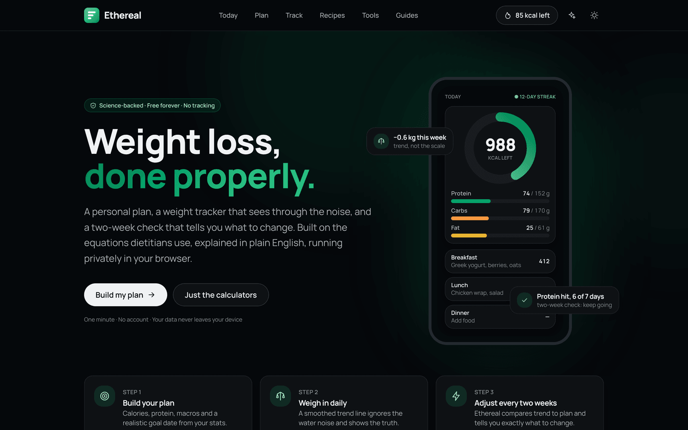</a>
</p>

<br/>

<table align="center">
  <tr>
    <td align="center"><b>1,444</b><br/><sub>halal-friendly foods, offline</sub></td>
    <td align="center"><b>66</b><br/><sub>high-protein recipes</sub></td>
    <td align="center"><b>20</b><br/><sub>chains ranked</sub></td>
    <td align="center"><b>18</b><br/><sub>evidence-based guides</sub></td>
    <td align="center"><b>8</b><br/><sub>calculators, one profile</sub></td>
    <td align="center"><b>0</b><br/><sub>accounts, ads, trackers</sub></td>
  </tr>
</table>

<br/>

## Why Ethereal exists

Most weight-loss apps are a subscription with a database attached. They hold your data, show you ads, and hide the maths. Ethereal is the opposite on every count.

- **The maths is open.** Every formula is explained in plain English on the [about page](https://bombastic482.github.io/Ethereal/about/) and lives in [`src/lib/calc`](src/lib/calc) as pure functions with tests beside them.
- **Your data is yours.** Everything stays in your browser. There is no backend to breach, no account to create, no analytics script to block. Export a full backup as JSON or CSV any time.
- **It adapts to you.** A smoothed weight trend sees through daily water noise. Every two weeks a check compares your real rate with the plan and recommends one specific, capped calorie change.
- **It is fast and costs nothing to run.** A static site that scores 100 on every Lighthouse category on a simulated slow phone and deploys to any static host's free tier.

## A tour

<table>
<tr>
<td width="50%" valign="top">

### Plan

Three steps to a personal plan: calories, protein, macros and a realistic goal date from your stats. Choose Mifflin-St Jeor, Harris-Benedict or Katch-McArdle. Deficits are capped and floored, so nothing reckless is ever suggested. After a few weeks of logging, Ethereal measures your real expenditure from your own intake and trend.

### Diary

Calorie ring, macro and fibre bars, four meals, water and steps. Type what you ate in a sentence ("2 eggs, a slice of toast and 150g greek yogurt"), search 1,444 foods that work offline, or scan a barcode and get Open Food Facts data with Nutri-Score and NOVA. Quick add, custom foods, saved meals, copy yesterday, favourites and "what to eat next" suggestions.

### Track

Daily weigh-ins, an exponentially smoothed trend, weekly averages, body measurements, notes, progress photos with a before-and-after slider, and a shareable progress card.

### Review

Sunday night, five minutes: the week in numbers, next week's decision applied in one tap, a twelve-week consistency grid, where the calories went, and pattern insights that link to the fix.

</td>
<td width="50%" valign="top">

### Recipes and planning

66 high-protein starter recipes built from the same database rows as the diary, each with its own page, nutrition table, serving scaler and social card. Plan a day or a whole week that lands on your targets, swap or lock slots, log it in one tap, share the shopping list.

### Eating out

The leanest order at 20 chains (Chipotle, McDonald's, KFC, Nando's, Subway, Pret, Greggs, Starbucks, Costa and more): 155 menu items ranked by protein per calorie, coffee-shop drinks by calories. Tick items to build an order, or enter the calories you have left and let **Best order** pick the highest-protein combination that fits. One tap logs the lot.

### Switch from another app

Import your history from MyFitnessPal, Lose It!, Cronometer or any CSV with dates and calories, macros or weight. A preview shows what was recognised; duplicates are skipped.

### Everything else

Eight calculators sharing one profile. Eighteen guides. Halal-friendly throughout: no pork, gelatin sweets or alcohol anywhere in the database, recipes or chains. Quick launcher (⌘K), keyboard shortcuts, calendar reminders, installable as an app, works offline, dark mode.

</td>
</tr>
</table>

<p align="center">
  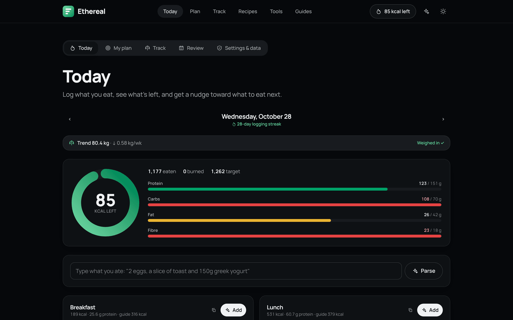
  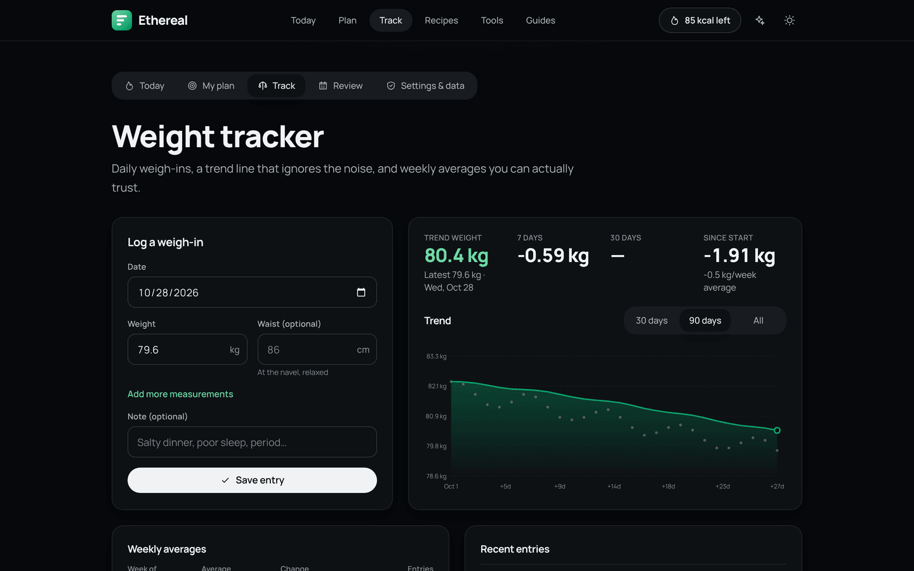
</p>
<p align="center">
  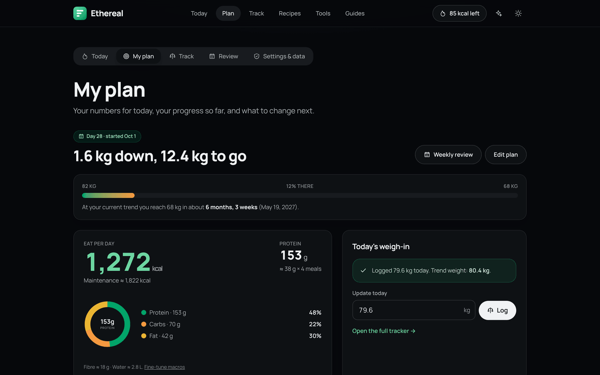
  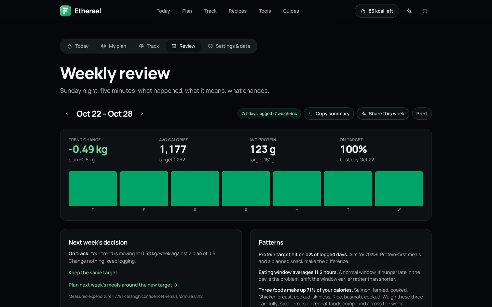
</p>
<p align="center">
  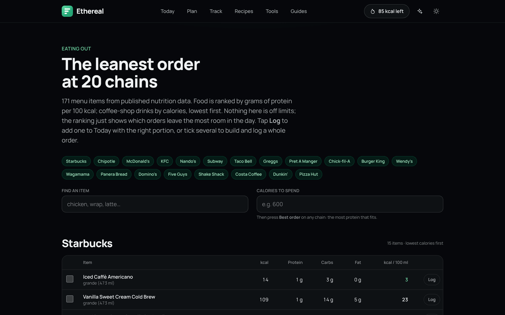
  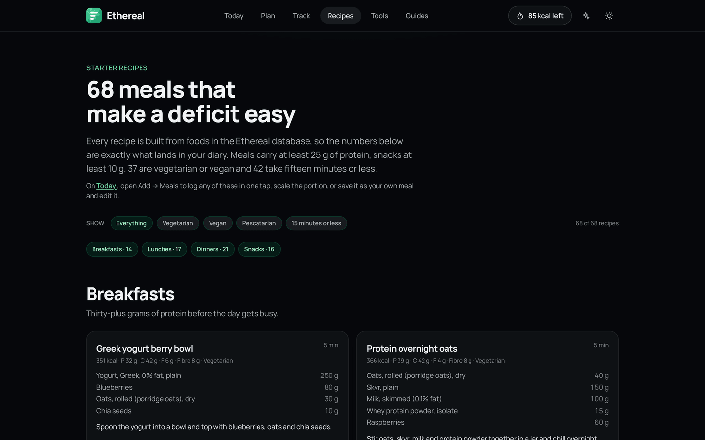
</p>
<p align="center">
  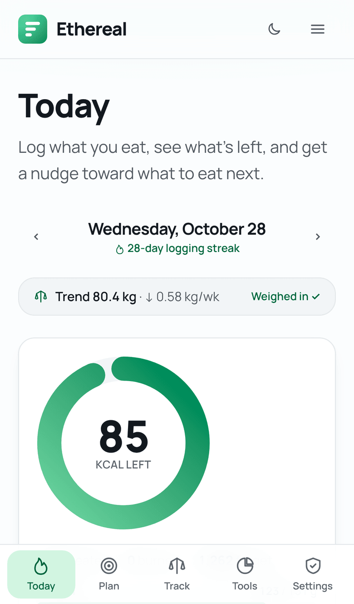
  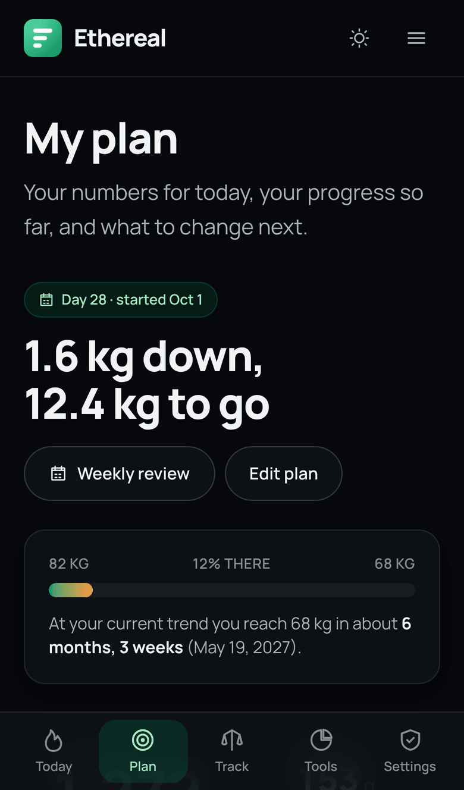
  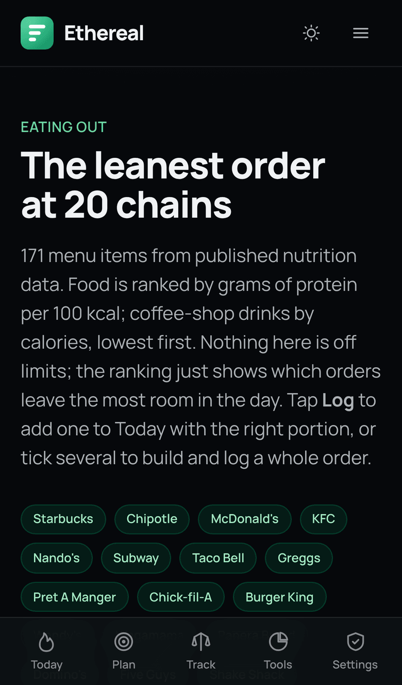
  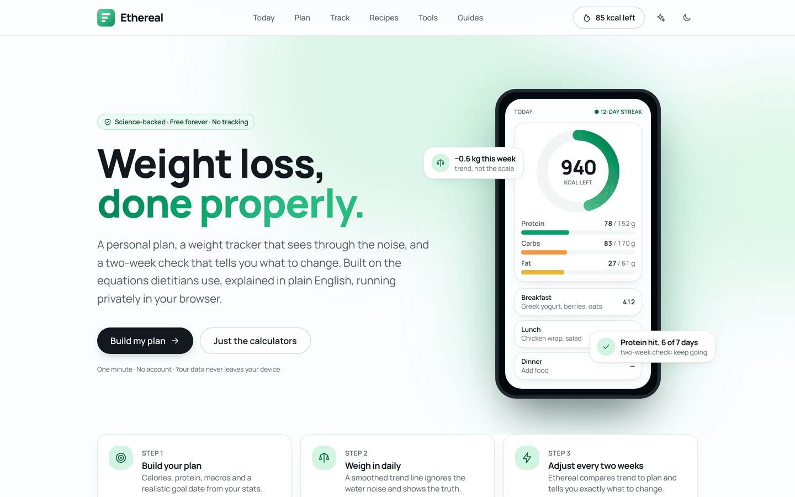
</p>

## How it thinks

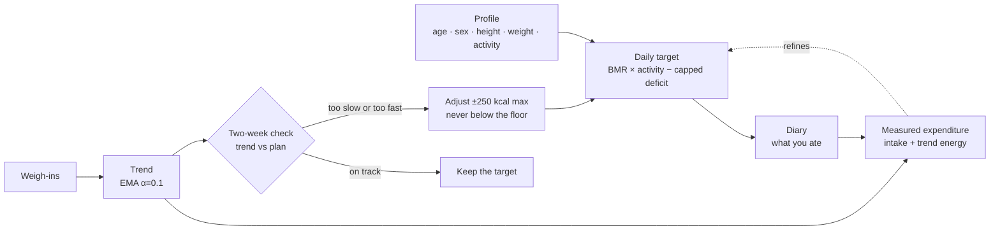

| Question             | Method                                                                                                                                                                                                       |
| -------------------- | ------------------------------------------------------------------------------------------------------------------------------------------------------------------------------------------------------------ |
| Maintenance calories | Mifflin-St Jeor by default; Harris-Benedict and Katch-McArdle (from body fat) available. Activity multipliers 1.2 to 1.9.                                                                                    |
| Daily target         | Deficit capped at 25 % of TDEE (the standard 550 kcal always allowed), floors of 1,200 kcal (female) and 1,500 kcal (male).                                                                                  |
| Goal date            | Week-by-week projection that recomputes maintenance as you get lighter, so the date is one you can plan around.                                                                                              |
| Trend weight         | Exponential moving average over daily weigh-ins with a 14-day slope, so a salty dinner never looks like failure.                                                                                             |
| Two-week check       | Compares the measured trend with the planned rate in a toward-goal frame (losing, gaining or maintaining), recommends at most ±250 kcal, never below the floors, with a 14-day cooldown between adjustments. |
| Measured expenditure | Average intake plus the energy implied by the trend change (7,700 kcal per kg), with a confidence grade based on how many days were logged.                                                                  |
| Protein              | 1.6 to 2.2 g per kg of body weight (higher per kg of lean mass when body fat is known), spread across meals.                                                                                                 |
| Body fat             | U.S. Navy circumference method.                                                                                                                                                                              |
| Insights             | Weekend drift, low-protein meal, fibre, snack share, late eating, eating window, concentration, takeaway share, consistency. Each only fires with enough data.                                               |

The [about page](https://bombastic482.github.io/Ethereal/about/) explains each with its evidence.

## Privacy, by construction

Static HTML and JavaScript. No server-side code, no database, no cookies, no analytics, no third-party requests. The one optional network call is the Open Food Facts API when you search for a packaged product or scan a barcode.

All data lives in `localStorage` (plan, diary, weigh-ins, preferences) and IndexedDB (progress photos). Export, import and clear everything from Settings. Share links encode your plan in the URL fragment, which never reaches a server.

## Quality bar

| Check                                                      | Covers                                                                                                                                                        |
| ---------------------------------------------------------- | ------------------------------------------------------------------------------------------------------------------------------------------------------------- |
| **144 unit tests** (Vitest)                                | Every calculation, the trend and adjustment engine, insights, CSV import, recipe planner, food search, the halal data guard, data stores and backup.          |
| **120 end-to-end tests** (Playwright, desktop and Pixel 7) | Onboarding, diary, planner, review, import, eating out, deep links, keyboard shortcuts, and an axe accessibility sweep of 25 pages in light and dark mode.    |
| **Lighthouse CI**                                          | Desktop budgets at 0.95 and above; a simulated-phone performance budget of 0.9 and above on the key pages.                                                    |
| **Data validators**                                        | Every food and recipe checked for shape, plausibility and energy consistency on each build. Nutrition audited against USDA SR Legacy and manufacturer labels. |
| **Type check and formatting**                              | `astro check` strict and Prettier across the tree.                                                                                                            |

## Keyboard

| Key             | Does                                        |
| --------------- | ------------------------------------------- |
| `⌘K` / `Ctrl+K` | Quick launcher: pages, tools, guides, foods |
| `a`             | Add food (on Today)                         |
| `w`             | Log a glass of water                        |
| `e`             | Log exercise                                |
| `⇧←` / `⇧→`     | Previous / next day                         |
| `?`             | Show the shortcut hint                      |

## Stack

[Astro](https://astro.build) static output · [Preact](https://preactjs.com) islands · [Tailwind CSS v4](https://tailwindcss.com) · TypeScript strict · Vitest · Playwright · Lighthouse CI · [sharp](https://sharp.pixelplumbing.com) for build-time social cards.

The diary page ships about 25 KB of gzipped JavaScript in total and loads the food database lazily in six 10 to 13 KB chunks. One self-hosted, subset, preloaded font file. A service worker caches the app shell and the eating-out page for offline use.

## Develop

```bash
npm install
npm run dev        # http://localhost:4321
npm run verify     # data validators + astro check + unit tests + production build
npm run build && npm run test:e2e   # Playwright against the built site
npm run format     # Prettier
npm run og         # regenerate public/og.png, icons and favicon from scripts/og.mjs
```

Requires Node 20+ (see `.nvmrc`). In a sandbox with a preinstalled Chromium, set `PW_CHROMIUM_PATH` to its binary before running the end-to-end suite.

## Deploy

Every push to `main` builds and deploys to GitHub Pages via [`.github/workflows/deploy-pages.yml`](.github/workflows/deploy-pages.yml). The build is base-path aware: under a GitHub project page it serves from `/Ethereal/`; on a custom domain or any other host it serves from `/`. Set `SITE_URL` (and `BASE_PATH` when not at the root) for canonical URLs, the sitemap and social cards; see `.env.example`.

| Host             | Setup                                                                                                 |
| ---------------- | ----------------------------------------------------------------------------------------------------- |
| GitHub Pages     | Settings → Pages → Source: _GitHub Actions_. The workflow does the rest.                              |
| Cloudflare Pages | Connect the repo · build `npm run build` · output `dist` · env `SITE_URL`. `public/_headers` applies. |
| Vercel           | Import the repo · framework Astro · env `SITE_URL`. `vercel.json` sets security headers.              |
| Netlify          | Build `npm run build` · publish `dist` · env `SITE_URL`. `public/_headers` applies.                   |

## Project layout

```
src/
  lib/calc/            the calculation engine: energy, macros, protein, timeline, trend,
                       expenditure, insights, breakdown, streaks, halal, chains (+ tests)
  lib/store.ts         tiny persistent store factory (localStorage, subscribe + hook)
  lib/profile.ts       one shared profile; every tool pre-fills from it
  lib/plan.ts          plan model and derived daily targets
  lib/log.ts           weigh-in log · lib/food-store.ts diary and preferences
  lib/foods.ts         offline food search · lib/off.ts Open Food Facts client
  lib/recipes.ts       starter recipes · lib/day-plan.ts day/week planner and shopping list
  lib/quick-parse.ts   natural-language entry · lib/import-csv.ts importer for other apps
  lib/*-build.ts       build-time views of recipes and chains for the static pages
  lib/og.ts            social card renderer (SVG → PNG at build time)
  data/                foods-a…f.json (six lazy chunks, 1,444 foods) and recipes.json
  components/          Preact islands (calculators, diary, planner, review) and Astro UI
  pages/               routes, og/ image endpoints, the web manifest
  content/guides/      eighteen Markdown guides, validated by content.config.ts
tests/e2e/             Playwright smoke, app, diary and accessibility suites
scripts/               data validators, og/icon generator, static server for tests
public/sw.js           service worker: offline-first assets, network-first pages
```

## Design

One typeface ([Manrope](https://fonts.google.com/specimen/Manrope)). White and near-black surfaces with cool neutral greys, a single green accent, generous spacing, no visual noise. The mark is an "E" of three bars that get shorter: a letter and a downward trend in one shape. Tokens live in [`src/styles/global.css`](src/styles/global.css); dark mode follows the system and can be overridden.

## FAQ

**Is it really free?** Yes. No account, no paywall, no premium tier. It is a static site, which costs almost nothing to host.

**Where does my data go?** Nowhere. It is saved in your own browser. Clearing site data removes it, so export a backup from Settings first.

**How accurate are the numbers?** They use the equations recommended in clinical nutrition. All estimates carry about ±10 % error, which is exactly why the two-week check exists: it corrects the plan from your real results.

**Can I use it to gain or maintain?** Yes. The plan, trend and two-week check all work in a toward-goal frame.

**Does it work offline and on my phone?** Yes. Install it from the browser menu; the app shell, your data and the eating-out page are available without a connection.

## Contributing

Issues and pull requests are welcome. Run `npm run verify` before opening one; CI runs the same checks plus the end-to-end suite and Lighthouse budgets. Food data corrections should cite a source (a manufacturer label, USDA SR Legacy or McCance and Widdowson).

## Licence

[MIT](LICENSE). Ethereal provides general educational information and estimates only; it is not medical advice.
