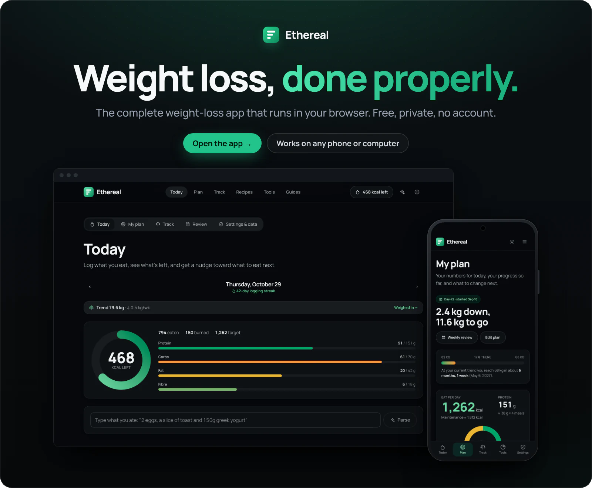
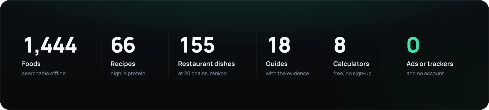
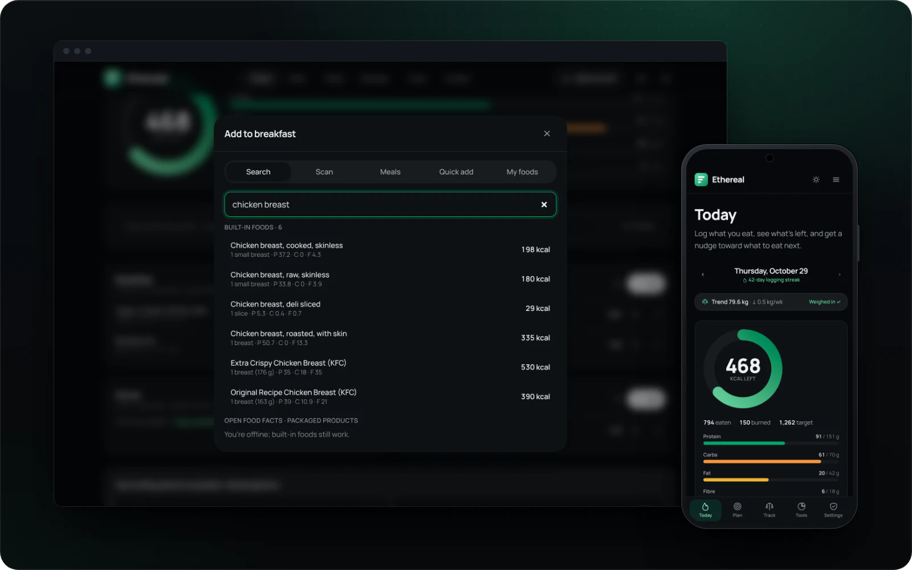
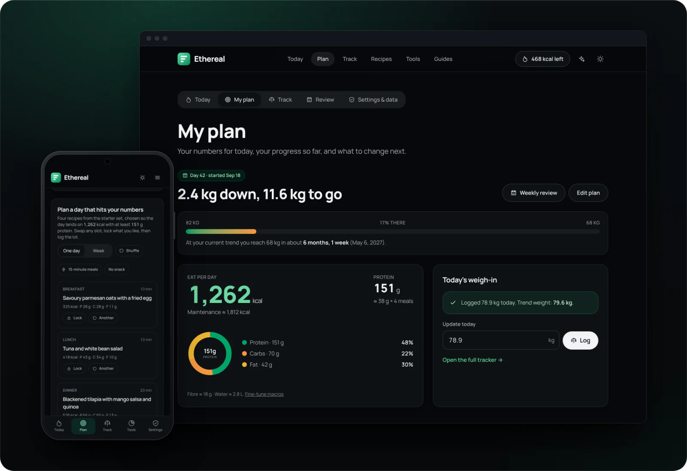
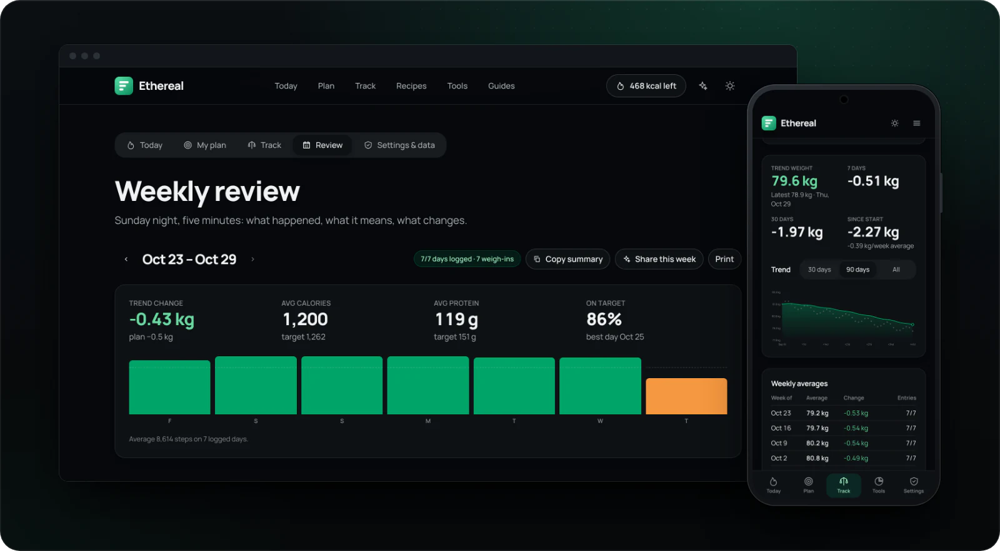
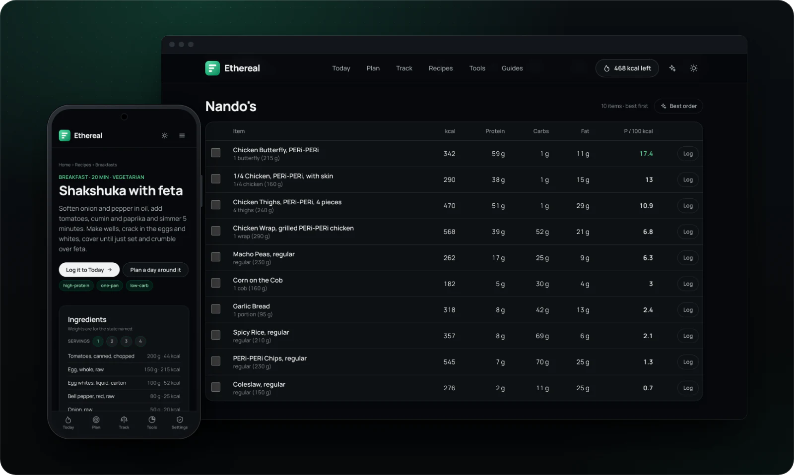
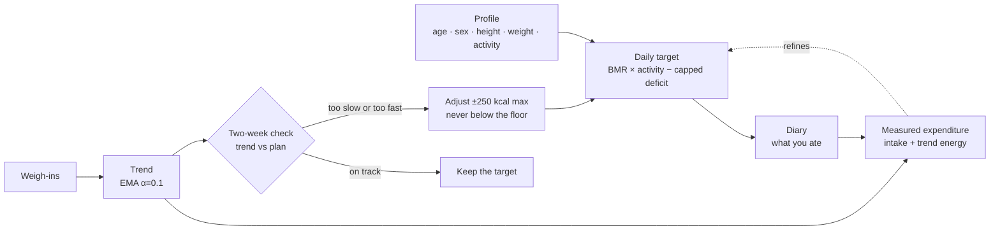

<a href="https://bombastic482.github.io/Ethereal/">
  <picture>
    <source media="(max-width: 700px)" srcset="docs/readme/hero-mobile.webp" />
    
  </picture>
</a>

<p align="center">
  <a href="https://bombastic482.github.io/Ethereal/"><b>Open the app</b></a>
  &nbsp;·&nbsp;
  <a href="https://bombastic482.github.io/Ethereal/about/">Methodology</a>
  &nbsp;·&nbsp;
  <a href="https://bombastic482.github.io/Ethereal/compare/">Compare</a>
  &nbsp;·&nbsp;
  <a href="https://bombastic482.github.io/Ethereal/changelog/">What's new</a>
</p>

<p align="center">
  <a href="https://github.com/bombastic482/Ethereal/actions/workflows/ci.yml"></a>
  
  
  
  
</p>

<br />

Most weight-loss apps are a subscription with a database attached. They keep your data, sell your attention and hide the maths.

**Ethereal is the opposite.** It is a complete weight-loss app that runs in your browser on any phone, tablet or computer: a personal plan, a food diary, a weight trend, recipes, restaurant guides and a weekly review. It is free and private, needs no account, and every formula is open.

<picture>
  <source media="(max-width: 700px)" srcset="docs/readme/numbers-mobile.webp" />
  
</picture>

<br />

## Log a day in seconds

Type what you ate in plain words, scan a barcode, or search 1,444 foods that work offline. The ring shows what is left, and the bars track protein, carbs, fat and fibre against your targets.

- **Plain-language entry.** "2 eggs, a slice of toast and 150g greek yogurt" becomes three logged foods in one tap.
- **Barcodes.** Packaged products come from Open Food Facts, with Nutri-Score and NOVA grades.
- **Shortcuts that add up.** Saved meals, favourites, copy yesterday, and a suggestion for what fits next.

<picture>
  <source media="(max-width: 700px)" srcset="docs/readme/diary-mobile.webp" />
  
</picture>

## A plan that adapts to you

Three questions give you a calorie target, protein, macros and a realistic goal date. Deficits are capped and floored, so the app never suggests anything reckless.

- **It learns your real burn.** After a few weeks it measures your actual expenditure from what you ate and how your trend moved.
- **Every two weeks, one decision.** It compares your real rate with the plan and recommends one specific, capped calorie change.
- **A day planner that hits your numbers.** It picks four recipes that land on your calories and protein. Swap or lock any slot, then log the lot.

<picture>
  <source media="(max-width: 700px)" srcset="docs/readme/plan-mobile.webp" />
  
</picture>

## See the trend, not the noise

Daily weigh-ins are smoothed into a trend, so water weight and one salty dinner never look like failure. On Sunday night the weekly review takes five minutes: the week in numbers, what it means, and next week's change applied in one tap.

<picture>
  <source media="(max-width: 700px)" srcset="docs/readme/track-mobile.webp" />
  
</picture>

## Food you will actually eat

- **66 high-protein recipes,** each built from the same food database as the diary, so what you cook is exactly what gets logged.
- **The leanest order at 20 chains.** 155 menu items ranked by protein per calorie. Enter the calories you have left and **Best order** picks the highest-protein meal that fits.
- **Halal throughout.** No pork, gelatin or alcohol anywhere in the foods, recipes or menus.

<picture>
  <source media="(max-width: 700px)" srcset="docs/readme/food-mobile.webp" />
  
</picture>

## Why it is different

|                  | Ethereal               | Typical apps                    |
| ---------------- | ---------------------- | ------------------------------- |
| Price            | Free, no premium tier  | Subscription for the good parts |
| Account          | None                   | Required                        |
| Your data        | Stays on your device   | On their servers                |
| Ads and trackers | None                   | Common                          |
| Calorie target   | Adapts every two weeks | Set once                        |
| The maths        | Open and documented    | Hidden                          |

The full comparison with MyFitnessPal, Lose It! and MacroFactor is on the [compare page](https://bombastic482.github.io/Ethereal/compare/).

## Install it anywhere

Open **[bombastic482.github.io/Ethereal](https://bombastic482.github.io/Ethereal/)**, then:

- **iPhone and iPad:** in Safari, tap **Share**, then **Add to Home Screen**.
- **Android:** in Chrome, open the menu and tap **Install app**.
- **Windows, Mac and Linux:** in Chrome or Edge, click the install icon in the address bar.

It opens in its own window like a native app and works offline. Already tracking elsewhere? Settings imports your history from MyFitnessPal, Lose It!, Cronometer or any CSV.

<br />

## Under the hood

<details>
<summary><b>How the maths works</b></summary>
<br />



| Question             | Method                                                                                                                            |
| -------------------- | --------------------------------------------------------------------------------------------------------------------------------- |
| Maintenance calories | Mifflin-St Jeor by default; Harris-Benedict, or Katch-McArdle from body fat. Activity multipliers 1.2 to 1.9.                     |
| Daily target         | Deficit capped at 25% of TDEE (550 kcal always allowed); floors of 1,200 kcal (female) and 1,500 kcal (male).                     |
| Goal date            | A week-by-week projection that recomputes maintenance as you get lighter.                                                         |
| Trend weight         | Exponential moving average of daily weigh-ins, with a 14-day slope.                                                               |
| Two-week check       | Trend rate against the planned rate in a toward-goal frame; at most ±250 kcal, never below the floors, 14-day cooldown.           |
| Measured expenditure | Average intake plus the energy implied by the trend change (7,700 kcal per kg), with a confidence grade.                          |
| Protein              | 1.6 to 2.2 g per kg of body weight, or per kg of lean mass when body fat is known, spread across meals.                           |
| Body fat             | U.S. Navy circumference method.                                                                                                   |
| Insights             | Weekend drift, low-protein meal, fibre, snacks, late eating, eating window, repeat foods, takeaway share. Each needs enough data. |

Every formula lives in [`src/lib/calc`](src/lib/calc) as a pure function with tests beside it, and the [methodology page](https://bombastic482.github.io/Ethereal/about/) explains each one with its evidence.

</details>

<details>
<summary><b>Privacy, by construction</b></summary>
<br />

Ethereal is static HTML and JavaScript: no server code, no database, no cookies, no analytics and no third-party scripts. The only optional network call is to Open Food Facts when you scan a barcode or search packaged products.

Your plan, diary, weigh-ins and preferences live in `localStorage`, and progress photos in IndexedDB. Settings exports, imports and deletes all of it. Shared plan links carry the plan in the URL fragment, which never reaches a server.

</details>

<details>
<summary><b>Quality bar</b></summary>
<br />

| Check                 | What it covers                                                                                                      |
| --------------------- | ------------------------------------------------------------------------------------------------------------------- |
| 152 unit tests        | Every calculation, the trend and adjustment engine, insights, CSV import, the planner and food search.              |
| 120 end-to-end tests  | Desktop and phone: onboarding, diary, planner, review, import, eating out, the tab bar, and an accessibility sweep. |
| Lighthouse CI         | Performance budgets on a simulated slow phone; key pages score 100.                                                 |
| Data validators       | Every food and recipe checked for shape, plausibility and energy consistency on each build.                         |
| Type check and format | `astro check` in strict mode and Prettier across the tree.                                                          |

</details>

<details>
<summary><b>Stack and architecture</b></summary>
<br />

[Astro](https://astro.build) static output, [Preact](https://preactjs.com) islands, [Tailwind CSS v4](https://tailwindcss.com), strict TypeScript, Vitest, Playwright and Lighthouse CI. Manrope is self-hosted, so no font request leaves the site.

```
src/
  lib/calc/        the calculation engine: energy, macros, protein, timeline, trend,
                   expenditure, insights, streaks, chains (with tests)
  lib/             stores, profile, plan, diary, food search, recipes, planner, importer
  data/            1,444 foods in six lazy chunks, and the recipes
  components/      Preact islands (diary, plan, review, calculators) and Astro UI
  pages/           every route
  content/         18 guides
tests/e2e/         Playwright suites
scripts/           data validators, social cards, README visuals
```

</details>

<details>
<summary><b>Run it locally</b></summary>
<br />

```bash
npm install
npm run dev        # http://localhost:4321
npm run verify     # data validators, type check, unit tests and a production build
npm run test:e2e   # Playwright against the built site
npm run format     # Prettier
```

Requires Node 20 or newer. Every push to `main` deploys to GitHub Pages. The build works at the domain root or under a sub-path; set `SITE_URL`, and `BASE_PATH` when not at the root, for canonical links and social cards (see `.env.example`). It also deploys as-is to Cloudflare Pages, Netlify or Vercel.

The images in this README come from `npm run readme:visuals`, which captures the built app and composes each scene.

</details>

<details>
<summary><b>Keyboard shortcuts</b></summary>
<br />

| Key             | Does                                        |
| --------------- | ------------------------------------------- |
| `⌘K` / `Ctrl+K` | Quick launcher: pages, tools, guides, foods |
| `a`             | Add food (on Today)                         |
| `w`             | Log a glass of water                        |
| `e`             | Log exercise                                |
| `⇧←` / `⇧→`     | Previous or next day                        |

</details>

## FAQ

<details>
<summary><b>Is it really free?</b></summary>
<br />
Yes. There is no account, paywall or premium tier. It is a static site, which costs almost nothing to host.
</details>

<details>
<summary><b>Where does my data go?</b></summary>
<br />
Nowhere. It is saved in your own browser. Clearing site data removes it, so export a backup from Settings first.
</details>

<details>
<summary><b>How accurate are the numbers?</b></summary>
<br />
They use the equations recommended in clinical nutrition, which carry about ±10% error for any one person. That is exactly why the two-week check exists: it corrects your plan from your real results.
</details>

<details>
<summary><b>Can I use it to gain or maintain weight?</b></summary>
<br />
Yes. The plan, trend and two-week check all work toward whichever goal you set.
</details>

## Contributing

Issues and pull requests are welcome. Run `npm run verify` before opening one; CI runs the same checks plus the end-to-end suite and Lighthouse budgets. Food data corrections should cite a source, such as a manufacturer label or USDA FoodData Central.

## Licence

[MIT](LICENSE). Ethereal provides general educational information and estimates. It is not medical advice.
